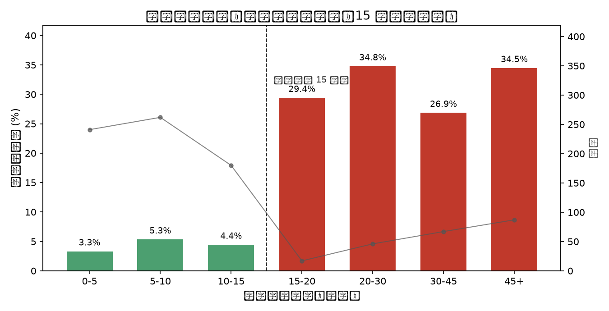

# 车间领料"空跑"归因与预警方案

> 任务：减少领料员因缺料导致的空跑等待，提升领料履约率。
> 数据：`data/raw/requisitions.csv`（题目发放，988 行，**未补造任何数据**）。

**一句话结论**：空跑不是"库存数量不够"，而是**账面库存既旧又虚** —— 领料单把一个「最后一次同步的账面余量」当成了实时可用量。在"提交时该物料库存快照已超过 15 分钟"的单上，空跑率从 4.4% 跳到 31.8%（7.2 倍）；用这一条规则可在 900 有效单中提前拦下 70% 的空跑，净省 1,920 工时（≈ 削减 26% 的 7,425 工时损失）。



---

## 1. 我的判断

### 1.1 看到了什么

先把 988 行洗干净再谈结论：

| 处理 | 数量 | 说明 |
|---|---|---|
| 原始行 | 988 | — |
| 完全重复行 | −47 | `req_id` 及其余字段完全相同，疑似重复入库；去重后 941 行 |
| `is_fulfilled` 未回传 | −41 | 4.4%，结果未知，主分析剔除（偏差检验见 §5） |
| **有效样本** | **900** | 其中空跑 **99** 单，**空跑率 11.0%** |

最扎眼的两个事实：

1. **99 次空跑里，90 次（91%）发生在"系统账面库存 > 0"的单上。** 领料员不是"看到 0 还硬跑"，而是**看到了一个非零数字，跑过去却没有** —— 与投诉原文完全对上。
2. **97.9% 的单，账面可领数量(`recorded_qty`)本来就小于计划批次数量(`plan_batch_qty`)**（中位数 15 vs 51），可整体履约率仍有 89%。若"数量不足"是原因，这 89% 无法解释。

### 1.2 根问题

把每单的 `requisition_time − stock_synced_at` 算出来 —— 这是**领料员眼前那个库存数字的年龄**：

| 快照延迟 | 单量 | 空跑 | 空跑率 |
|---|---|---|---|
| 0 分钟 | 63 | 1 | 1.6% |
| 1–5 分钟 | 220 | 10 | 4.5% |
| 5–10 分钟 | 269 | 15 | 5.6% |
| 10–15 分钟 | 131 | 4 | 3.1% |
| **15–20 分钟** | 17 | 5 | **29.4%** |
| 20–30 分钟 | 53 | 19 | **35.8%** |
| 30–45 分钟 | 64 | 16 | **25.0%** |
| 45 分钟以上 | 83 | 29 | **34.9%** |

**15 分钟是一道断崖：≤15 分钟空跑率 4.4%（683 单），>15 分钟 31.8%（217 单，7.2 倍）。** 全部空跑中 69 次（70%）落在过期快照上。

> **根问题：`recorded_qty` 是「最后一次同步时的账面余量」，被当作实时可用量展示；而这个账面余量长期没有因为出库被实时冲减 —— 账高于实。**
> **账实不符才是实质，快照年龄只是它可见的标志。** 两者是同一个缺陷的两面：数字既旧、又虚。

### 1.3 机制检验：不是"这 15 分钟里被别人抢走了"

这是我第一版写过、后来被数据否掉的解释。检验如下：

| 检验 | 结果 | 判断 |
|---|---|---|
| 单量强度 | 每厂每小时仅 **2.2–2.7 单**，15 分钟窗口内平均不到 1 单 | 抢料的物理机会本来就少 |
| 同厂同料 15 分钟内重叠 | 只有 **50/900 单（5.6%）** 前面还有一单 | 最多解释个位数空跑 |
| 后到者是否更易失败 | 14.0% vs 10.8%（n=50，按基线期望失败 5.4 次、实际 7 次） | **落在噪音范围内，无显著差异** |
| 旧数是否偏大 | 陈旧行 `recorded_qty` 均值 14.88/14.83/15.52，中位数都是 15 | 不存在"旧数更乐观"的偏差 |

**结论：该机制被否掉。** 它解释不了"69 次空跑发生在陈旧快照上"这个量级。要区分"被消耗"与"从来没记准"，需要库存流水/盘点记录，**本数据没有** —— 所以我的主张只到"账面数不可信"，不指向具体成因。

### 1.4 排除掉的替代解释

| 替代解释 | 是否成立 | 反证 |
|---|---|---|
| 账面数量 < 计划批次 → 缺料 | ❌ | 97.9% 的单都满足，履约率仍 89%；且数量比越低，空跑率并非单调上升；用它做预警**净亏 1,815 工时**（§3） |
| 某个厂区管理差 | ❌ | 四厂空跑率 10.2%~12.0%，几乎持平；快照>15min 占比都是 21%~27% |
| 某类物料特别容易缺 | ❌（弱） | 物料间 7.0%~17.1%；但快照>15min 后**所有**物料同时抬升到 23%~45%，物料是放大器不是开关 |
| 某个班次/夜班缺同步 | ❌ | 7:00–21:00 各时段空跑率 3%~17%，快照>15min 占比各时段都是 15%~30%，延迟全天候随机发生 |

### 1.5 一个必须点出的口径疑点

`recorded_qty` 中位数 15、`plan_batch_qty` 中位数 51，97.9% 的单"账面 < 计划"却有 89% 履约成功；且 `recorded_qty` 几乎均匀铺满 0–30（每个整数 25–42 单，取上限仅 3.2%），不像真实物理库存分布。

**这两个字段大概率不是同一计量口径**（件/套/托，或按行按批）。这正是主数据该统一而没统一的东西，也是我**拒绝对数量做任何规则**的原因：拿口径不明的字段做判断，比不做更危险。

---

## 2. 做了什么

1. **洗数据**：去 47 行完全重复；统一时区（`requisition_time` 是 `+08:00`，`stock_synced_at` 是 `Z`(UTC)，直接相减会平白多出 8 小时 —— 真陷阱，脚本里显式处理）；41 条未回传单独隔离而非计 0。
2. **造一个特征**：`stale_min = requisition_time − stock_synced_at`，即"眼前的库存数字有多旧"。
3. **定位断崖**：分桶看空跑率，找到 15 分钟拐点；用"延迟 × 数量比"交叉表证明**时效解释数量**。
4. **反向检验机制**：主动构造"抢料"假说并用并发度、窗口重叠、序位失败率、旧数偏差四个角度检验，**否掉自己的第一版解释**。
5. **做规则 + 算钱**：用题目成本口径（空跑 75 工时 / 预警 15 工时）对候选规则逐一试算净收益，把"直觉规则"放进来做对照。

---

## 3. 怎么证明有用

### 3.1 盈亏线

一次空跑 75 工时、一次预警 15 工时 → **预警命中率必须 > 20%（15/75）才是正收益**。这是评价一切规则的硬标准。

### 3.2 规则对比（900 单实测）

| 规则 | 预警次数 | 拦下空跑 | 命中率 | 覆盖率 | **净节省工时** |
|---|---|---|---|---|---|
| **R：快照 > 15 分钟即提示** | 217 | 69 | 31.8% | 69.7% | **+1,920** |
| 快照 > 20 分钟 | 200 | 64 | 32.0% | 64.6% | +1,800 |
| 快照 > 15 分钟 且 数量比 < 0.4 | 149 | 53 | 35.6% | 53.5% | +1,740 |
| 对照：数量比 < 0.3 | 446 | 65 | 14.6% | 65.7% | **−1,815** |
| 对照：数量比 < 0.2 | 300 | 53 | 17.7% | 53.5% | **−525** |

- 规则 **R** 命中率 31.8%，是盈亏线的 1.6 倍；覆盖 70% 空跑；净省 **1,920 工时** = 削掉 7,425 工时损失的 **26%**。
- 两条"数量"对照规则命中率 14.6% / 17.7%，**低于盈亏线，越用越亏** —— 这证明"看起来最对的指标"恰恰是噪音。

### 3.3 复现

```bash
python -m venv .venv && .venv/Scripts/pip install -r requirements.txt   # Windows
python scripts/profile.py data/raw/requisitions.csv    # 数据体检
python scripts/analyze.py                              # 生成 analysis/report.md 与本文所有数字
```

`analysis/report.md` 是脚本直接输出的完整数值报告，本文每个数字都能逐条对应；表格由脚本生成，未手工改写。

---

## 4. 方案：先止血，再治本，最后才谈组织

### 4.1 止血（1 周内，改动最小）

- 领料单上**显示快照年龄**：>15 分钟标黄、>30 分钟标红，提交前提示"库存数据已 X 分钟未更新"。
- 提交时触发 **refresh-on-read**（现查一次），把最坏情况从"白跑一趟（75 工时）"降级为"多等 3 秒"。
- 收益是模型估算的 1,920 工时，**必须灰度 A/B 验证**，不能当实测结论。

### 4.2 治本（1–2 个月）：把"快照"换成"余额 + 预占"

| 层次 | 做法 | 解决的问题 |
|---|---|---|
| 事务实时过账 | 领料/出库/退料/调拨/盘盈亏事件驱动回写（CDC + 消息队列 + outbox + 幂等键），不再依赖定时批量 | 账面永远滞后 |
| **预占 reservation** | 提交领料单即锁定数量，发料才转扣减 | **并发超卖**："两人同时看到有货，只有一人拿到" |
| 可用量 ATP | 展示 `账面 − 已预占 − 冻结(待检) − 在途未入库`，而不是展示账面 | 账面有货、实际不可用 |
| 时效指标化 | `sync lag` P95 < 60s 作为 SLI；接口返回 `{qty, as_of}` 让调用方自行判断新鲜度 | 时效靠指标，不靠感觉 |
| 现场 | PDA 扫码出入库 | 减少人工补录窗口 |

### 4.3 主数据（MDM）：按"字段级写入权"划分，而不是按系统分层

**先说现实**：教科书会讲 MDM 只管定义、WMS 管余额。但集团多厂、ERP 版本不一、自研系统混杂时，点对点集成是 N×N 条链路，挂到 MDM 是 N 条 —— **治理成本的算术决定了 MDM 事实上就是那个 hub，还承担业务数据的分发与回传**。这不是架构师不懂分层，而是分不起。

所以不要争"该不该"，而是**把"系统边界"换成"字段级写入权"** —— 系统可以是一个，写入权必须唯一：

| 字段 | 唯一写入方 | 其他方 | 时效 |
|---|---|---|---|
| 物料编码 / 名称 / 分类 | MDM | 只读 | T+0 |
| **计量单位与换算** | **MDM** | 只读 | T+0（本案首要缺口） |
| 可用工厂 / 默认库位 / 替代料 | MDM | 只读 | 小时级 |
| 安全库存 / 采购提前期 | 计划部门（经 MDM 发布） | 只读 | 天级 |
| **实际余额 / 预占 / 出入库流水** | **WMS（唯一写入点）** | MDM 只存只读快照 | **秒级** |
| 领料执行结果 | WMS → 回传 | MDM 汇总 | 分钟级 |

判断标准很简单：**一个数据只要有两个系统都能改，它迟早会不一致。** 治理成本高时，正解不是合并系统，而是**收敛写入点**。

既然 MDM 事实上在传播业务数据，就必须给它装三个约束：

1. **发布-订阅，不是点对点文件交换** —— 否则只是把 N×N 的耦合藏起来，出问题查不清版本。
2. **版本 + 生效时间**（`version` / `effective_from`），接收方按版本落库 —— 没有版本的 hub 迟早出现"旧报文覆盖新数据"。
3. **hub 必须可降级** —— 各厂本地缓存 + 断连继续作业 + 恢复后对账，不能让车间因为主数据服务抖动而停线。

**在本案里，如果 MDM 就是那个 hub，修复点要相应改写**：`stock_synced_at` 落后 15 分钟就不是"某个系统的 bug"，而是 **hub 的同步节拍缺陷**。那么该做的是把 hub 的领料回写从批量改准实时，并把"超龄快照占比"（本数据 24.1%）作为 hub 的运营指标 —— 而不是继续争论它该不该存。

### 4.4 三步走（承认现状，逐步收敛）

| 阶段 | 动作 | 成本 | 收益 |
|---|---|---|---|
| 现在（1 周） | 快照年龄上屏 + 15 分钟预警（规则 R） | 极低 | 止血，模型值 1,920 工时 |
| 下季度 | 一页纸「字段级写入权清单」，先定 3 个最要命的字段：单位、可用库存、可用工厂 | 低（主要是开会） | 止住口径分叉 |
| 半年内 | 高频字段（余额/预占）迁事件流，hub 只留只读快照 + 订阅；给 hub 定 lag P95 | 中 | 从"靠人盯"变"靠指标" |

**治理成本高，不等于不能治理，只代表不能一次治完。** 先治那个"错一个字段就让人白跑一趟"的字段。

---

## 5. 口径、假设与局限

**口径**
- "空跑" = `is_fulfilled == 0`；为空（41 单）视为未知，剔除而非计 0。
- "快照延迟" = 本地时间下的 `requisition_time − stock_synced_at`，两者先归一到 UTC 再折算。
- 成本严格按题目给定（75 / 15 工时），未自行加权重。

**假设（题目未明确、我自行判断）**
1. 预警后领料员会先确认再决定是否跑仓 —— 拦下的空跑记 75 工时，误报只计 15 工时。若误报另引发沟通成本，把 15 调高即可：规则 R 在预警成本 ≤ 22.7 工时时仍为正收益。
2. 未回传 41 单与已回传同分布。已核对：未回传单中快照>15min 占 17.1%，已回传 24.1%，与时效不相关，剔除不改变时效结论；但未回传单略偏向低库存（数量比<0.15 占 39.0% vs 26.6%），故"数量"相关结论说得更保守。
3. 快照延迟源于系统同步间隔，而非人为改时间 —— 数据中无反向证据（延迟无负值）。

**局限（坦白）**
- 7 天、4 厂、941 行横截面，**没有库存流水明细**，因此"账面数被谁吃掉"只能从结果反推，无法验证扣减链路。
- **机制只到"账实不符 + 时效是标志"，无法区分"被消耗"还是"从来没记准"。** 第一版"被同期领走"的解释已被数据否掉（§1.3），这是本次分析中我自己推翻自己的地方。
- 15–20 分钟档只有 **17 单**，阈值附近样本不密；15 分钟是这份数据的经验拐点，上线应灰度 1–2 周再固化。
- 没有"预警后是否真的没跑"的线上实验，**1,920 工时是模型估算，不是实测收益**；要证实需 A/B：随机一半过期单强制确认，比对空跑率。
- 剩余 30% 的空跑无法被时效解释（快照新鲜仍缺料），可能来自拣货错误、账实差异的其他成因、单据重复等，**这些字段数据里没有，我不臆测**。

---

## 6. 改动记录（48 小时窗口内）

**第 2 版（本次提交）**
1. **修正机制表述**：删除"同步间隔内被其它工单/厂区领走"的原始解释（数据否掉了，见 §1.3），改为"账面未实时冲减 → 账实不符，快照年龄是其可见标志"。
2. **新增机制反证**：并发强度（每厂每小时 2.2–2.7 单）、窗口重叠（5.6%）、序位失败率差异在噪音内（14.0% vs 10.8%，n=50）、旧数无偏大 —— 四条一起否掉"抢料"假说。
3. **新增口径疑点**：`recorded_qty` 与 `plan_batch_qty` 不可比（97.9% vs 89%），作为主数据缺口的具体证据。
4. **方案从理想分层改为务实分层**：加入"MDM 事实上承担业务数据分发"的现实前提、字段级写入权表、hub 三约束、三步走路径。
5. 脚本相应扩展：`scripts/analyze.py` 新增 §5 机制检验、§6 口径检查，全部数字可复算。

**第 1 版**：数据体检、15 分钟断崖、规则 R 与经济性测算、替代解释排除、局限声明。
